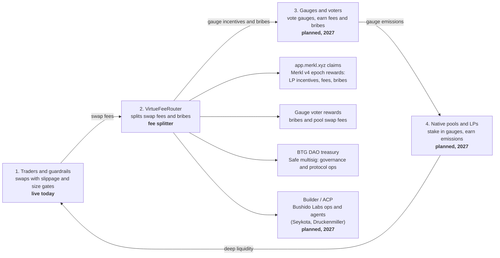

# The Bushido ve(3,3) flywheel

This page is the system overview for the Bushido protocol, written from the owner's flywheel diagram (November 2026).
**It describes the intended design, not a deployed system**: the "What exists today" section says what is built, and
anything marked "planned" has no code yet.

**BVS** is the Bushido Virtue Score. It is the "Virtue" in step 3 below: a voter's weight is their tokens scaled by
their score, capped at 2x.

The mechanics follow the Velodrome / Aerodrome ve(3,3) model: traders pay swap fees, fees and bribes are routed to
gauges, voters direct emissions to pools, and deeper pools give traders lower slippage.

## The loop, in words

1. **Traders and guardrails.** Swaps run through aggregator routes with slippage and size limits. Each swap pays a fee.
2. **VirtueFeeRouter.** Receives swap fees and bribes and splits them between gauge incentives and the fee receivers
   below.
3. **Gauges and voters.** Token holders vote on gauges; their weight scales with a Virtue multiplier, capped at 2x
   (`tokens x (1 + Virtue)`, at most 2x). Voters earn the fees and bribes of the gauges they vote for.
4. **Native pools and LPs.** LPs stake in gauges and earn emissions. Deeper liquidity lowers slippage for traders,
   which closes the loop.

## Fee receivers

| Receiver | What it gets |
|---|---|
| app.merkl.xyz claims | Merkl v4 epoch rewards: LP incentives, fees and bribes, claimed on app.merkl.xyz |
| Gauge voter rewards | Bribes and pool swap fees, claimed through Merkl or the gauges |
| BTG DAO treasury | A Safe multisig wallet for governance and protocol operations |
| Builder / ACP | Bushido Labs operations and the agents (Seykota, Druckenmiller) |

## What exists today

| Part | What exists | Status |
|---|---|---|
| 1. Traders and guardrails | The Bushido-dApp swap tab (repository `Monad-OPSTACK-DEX`); the swap orchestrator and its safety policy (repository `bushido-virtuals`) | The dApp is live. The orchestrator produces **dry-run plans only**; live execution is not implemented |
| 2. VirtueFeeRouter | A contract | Mainnet deployment is the owner's to run; not verified from here |
| Merkl claims | Claim and view code in the Bushido-dApp | Not exercised end to end |
| 3. Gauges and voters | Nothing | Planned, 2027 |
| 4. Native pools and LPs | Nothing | Planned, 2027 |
| Builder / ACP | The Seykota and Druckenmiller agent handlers in `bushido-virtuals` | Handlers parse (checked in CI); ACP integration is parked |

## Not verified

- The split percentages inside VirtueFeeRouter are not stated in the diagram and are not recorded here.
- No contract address appears on this page on purpose: addresses are added only after being read on-chain.
- The diagram labels the swap rails "0x v2"; the dApp routes through several sources (KyberSwap, LI.FI, 1inch, 0x and
  others), so this page says "aggregator routes".
- How this repository's own code (the app and `agent.config.ts`) maps onto the flywheel has not been reviewed.
